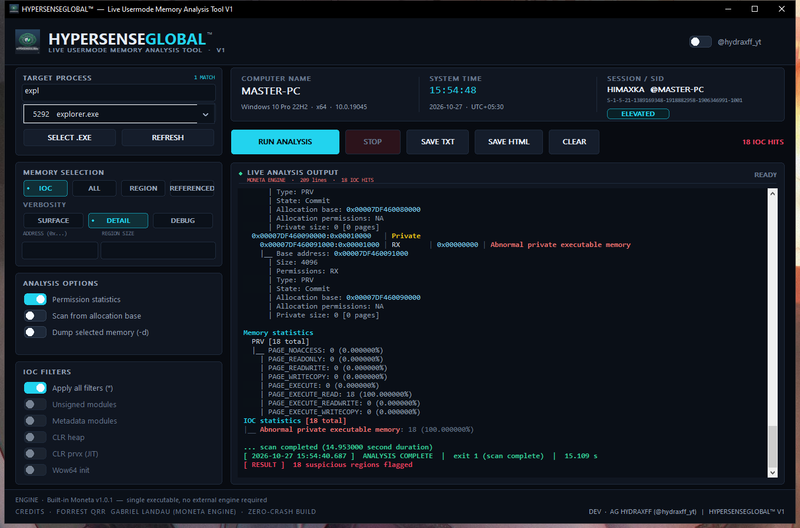

<p align="center">
  
</p>

<h1 align="center">HYPERSENSEGLOBAL&trade;</h1>

<p align="center">
  <b>Live usermode memory analysis for Windows</b><br>
  <sub>Single executable &middot; no installer &middot; no kernel driver &middot; no telemetry</sub>
</p>

<p align="center">
  <a href="https://github.com/hypersenseindia/hypersense-memory-analyzer/releases"></a>
  
  
  
  
</p>

---

HYPERSENSEGLOBAL is a Windows front end for the [Moneta](https://github.com/forrest-orr/moneta)
memory scanner. It inspects a running process and reports memory that looks like an
injection: private executable pages, modified code sections, unsigned or metadata-less
modules, CLR heaps and JIT regions.

The scanner is **compiled into the executable** — there is no second binary to ship and no
`Moneta64.exe` to keep next to it. The GUI talks to it as a hidden child process, so a
crash inside the scanner can never take the window down with it.

<p align="center">
  
</p>

## Features

> **New in this build:** see **[docs/WHATS_NEW.md](docs/WHATS_NEW.md)** for the old vs new
> comparison against the last public build.

| | |
| --- | --- |
| **One file** | `HyperSense64.exe`, ~1.7 MB, statically linked. Copy it anywhere and run it. |
| **Target search** | Filter the process list live by name, full image path or PID. Shows the match count and falls back to the first hit. |
| **Four memory modes** | `IOC` (suspicious regions only), `ALL`, `REGION` (one address range / region size) and `REFERENCED` (regions that reference a given address). |
| **IOC filters** | Apply all, unsigned modules, metadata modules, CLR heap, CLR JIT (`prvx`), WOW64 initialisation. |
| **Live output** | The scanner streams to the window as it works; 30 000 lines are rendered, the full log is always kept for the report. `OUTPUT` / `COMMAND` / `DETAILS` tabs show the run itself, the exact engine command line and the resolved settings. |
| **Right-click actions** | Right-click any path in the output to open it, show it in Explorer, copy it, or **search its SHA-256 on VirusTotal** in your default browser. `Ctrl+click` opens a path directly. |
| **Classic mode** | A `moneta64.exe`-style one-row layout: pick a process, run, read the output. A `PRESET` list fills in standard `moneta64.exe` command lines (`-m ioc -p <pid>`, `-v detail`, `--filter *`, `-d`, …) with the selected PID, and the `COMMAND` box stays editable — press Enter to run what you typed. |
| **Unsigned focus** | `FOCUS UNSIGNED` highlights unsigned modules and dims signed/routine lines so real IOCs stand out. |
| **Discord Rich Presence** | Automatic, no toggle: your Discord profile shows the process being scanned, the mode, the suspicious count and a live elapsed timer while the scan runs, with **GitHub** and **Join our Discord** buttons. Status travels over Discord's local IPC pipe only. |
| **Tooltips everywhere** | Every control explains itself on hover, including the shortcuts. |
| **Reports** | `SAVE TXT` and `SAVE HTML` write host name, account, SID, OS build, elevation, timestamps, options, result and the complete engine output. |
| **Isolation** | The scanner runs out of process (`--engine`, no console window). `STOP` terminates it immediately; the UI stays responsive. |
| **No surprises** | `asInvoker` manifest, opt-in elevation button, no drivers, no services, no autorun, no telemetry. The only outbound actions are the ones you start yourself: **Search on VirusTotal** opens a report in your browser, and Discord Rich Presence talks to the local Discord client only. |

## Quick start

1. Download `HyperSense64.exe` from [Releases](https://github.com/hypersenseindia/hypersense-memory-analyzer/releases).
2. Right-click → **Run as administrator** (or use the **ELEVATE** button) to inspect protected processes.
3. Pick a target — type in **TARGET PROCESS** to filter, or choose **ALL PROCESSES** for a system-wide run.
4. Press **RUN ANALYSIS** and watch **LIVE ANALYSIS OUTPUT**. **STOP** ends the scan at any time.
5. **SAVE TXT** or **SAVE HTML** exports the result.
6. Right-click any file path in the output for **Open**, **Show in folder**, **Copy** or
   **Search on VirusTotal** (SHA-256, opened in your browser). `Ctrl+click` opens it too.

A typical run against `explorer.exe`:

```
  [ 2026-10-27 15:54:40.687 ]  ANALYSIS COMPLETE  |  exit 1 (scan complete)  |  15.109 s
  [ RESULT ]  18 suspicious regions flagged
```

> The engine exits with code **1 on a successful scan** — that is Moneta's convention, not a failure.

Only one window runs at a time — launching the tool again simply brings the open window to the
front.

## Classic mode (moneta64.exe style)

Switch on **CLASSIC MODE** in the header for the plain one-row layout: type in the search box,
pick the process from the list and press **RUN ANALYSIS**. The `PRESET` dropdown fills the
`COMMAND` box with a literal command line, for example:

```
moneta64.exe -m ioc -p 11044
moneta64.exe -m ioc -p 11044 -v detail
moneta64.exe -m ioc -p 11044 --filter *
moneta64.exe -m ioc -p 11044 -d
moneta64.exe -m ioc -p 11044 -v detail --option statistics --filter *
```

`<pid>` is always replaced by the process selected in the list (or by the optional PID
override). The `COMMAND` box is editable: change any argument and press **Enter** to run it,
or **Esc** to restore the line generated from the current settings. The GUI translates it
back into its own settings, so `COMMAND`, `DETAILS` and the saved report stay in sync.

## Discord Rich Presence

Rich Presence runs automatically — there is no toggle and nothing to configure. While the
tool is open, your Discord profile shows the current activity: the process being scanned,
`IOC · DETAIL · 3 suspicious`, and a live elapsed timer that becomes the final result
(`Scan clean` / `12 suspicious regions`). The card has **GitHub** and **Join our Discord**
buttons ([discord.gg/me7DvyzUp3](https://discord.gg/me7DvyzUp3)). Closing the tool clears
the status.

It only talks to the Discord desktop client over its local IPC pipe — the app itself sends
nothing to a server. The Client ID can be overridden in `HyperSense.ini` if you fork the
build for your own Discord application:

```ini
[discord]
client_id=1564751949201543358
```

The `HYPERSENSE_DISCORD_CLIENT_ID` environment variable works too.

## Build from source

Requirements: Windows 10/11 x64, [MSYS2](https://www.msys2.org/) with the `ucrt64` toolchain.

```bat
cd HyperSense
build.bat
```

Output: `HyperSense\HyperSense64.exe`, copied to the repository root. Full details,
troubleshooting and the CI recipe are in **[docs/BUILDING.md](docs/BUILDING.md)**.

## How it works

```
HyperSense64.exe  (GUI, Win32/Direct2D, asInvoker)
   └─ CreateProcessW(self, "--engine <moneta args>", CREATE_NO_WINDOW)
         └─ Moneta engine  ──stdout pipe──▶  live view + report
```

The GUI re-launches **itself** with `--engine` and the equivalent Moneta command line.
That keeps the analysis in a disposable process: a fault in the scanner costs you the
scan, not the session. The design and the safety fixes applied to the engine while
porting it to MinGW are described in **[docs/ARCHITECTURE.md](docs/ARCHITECTURE.md)**.

## Antivirus and false positives

A memory scanner opens other processes with `PROCESS_VM_READ`, walks `PEB`/`TEB` and
enables `SeDebugPrivilege` before a scan. Binaries doing that are regularly scored as
PUA/hacktool by machine-learning engines.

Both flavours ship twice — Authenticode-signed (`CN=HYPERSENSEGLOBALT`, SHA-256, DigiCert
timestamp) and unsigned. The last scanned build scores **1/71 on VirusTotal**: Microsoft
clean, every other engine clean except SecureAge, which reports `Malicious` (a generic
static-ML verdict). Version **1.0.2 changes the hashes**, so scan the file you are about to
publish — do not carry that number over. Earlier builds were flagged by Microsoft as
`Program:Win32/Wacapew.Cml` and `Trojan:Win32/Wacatac.C!ml`; the name moves between builds
because it is a cloud ML score on the whole file, not a property of the source, so a rebuild is
not a fix. The import table is kept deliberately boring for that reason — no clipboard,
key-state or crypto-provider calls, and SHA-256 lives in `src/sha256.h`. If a scanner flags
your copy, do **not** disable your antivirus — read
**[docs/FALSE_POSITIVES.md](docs/FALSE_POSITIVES.md)**, which includes the submission text and
the signing procedure. Ready-to-paste vendor forms live in
**[docs/MICROSOFT_FP.txt](docs/MICROSOFT_FP.txt)** and
**[docs/SECUREAGE_FP.txt](docs/SECUREAGE_FP.txt)**.

The signing certificate is **self-signed**, so on a machine that has not installed its root
Windows still shows *Unknown publisher*; a CA-issued OV/EV certificate is what removes that
warning and carries real SmartScreen reputation.

The four release files (`HyperSense/HXG SIGNED/`):

| File | Size | Signature | SHA-256 |
| --- | --- | --- | --- |
| `HyperSense64 -unsigned.exe` | 1,845,760 | none | `568a1b428ddf4e46529d503a2dcd4b25fbaac708ed8312e0da426201d31b5f7a` |
| `HyperSense64 HXG SIGNED.exe` | 1,852,920 | `CN=HYPERSENSEGLOBALT` | `bcd48830528cb21166c4370c7a7e90b93e74ee12b0ede23d96e10fa15deb4df0` |
| `HyperSense64 CLASSIC -unsigned.exe` | 1,845,760 | none | `53d1e04483a9ec76baf2012e9d01c15904efe09be86458b6bc56d8f4b9a69542` |
| `HyperSense64 CLASSIC HXG SIGNED.exe` | 1,852,920 | `CN=HYPERSENSEGLOBALT` | `eb3764631f6d314f88271af0c039989307cc5da2ed9dc65e1a3cc7938f278a4a` |

`CLASSIC` is the same program, built to open straight into the `moneta64.exe`-style one-row
screen (`build.bat classic`); the toggle still switches either file between both layouts.

## Intended use

HYPERSENSEGLOBAL is a diagnostic tool for **systems you own or are authorised to test**
— malware triage, incident response, reverse engineering, detection engineering.

It does not inject code, does not modify the target, does not persist anything and does
not contact any network endpoint by itself. It reads memory and writes the report you ask
for. The optional **Search on VirusTotal** action only computes a local SHA-256 and hands
the URL to your browser — nothing is uploaded by this program. **Discord Rich Presence**
passes the scan status to the Discord client running on your machine; what Discord does with
that is governed by your Discord privacy settings, and closing the tool clears the status.

## Contributors

<table>
  <tr>
    <td align="center" width="170">
      <a href="https://github.com/forrest-orr">
        <br>
        <sub><b>Forrest Orr</b></sub>
      </a><br>
      <sub>Moneta engine</sub>
    </td>
    <td align="center" width="170">
      <a href="https://github.com/gabriellandau">
        <br>
        <sub><b>Gabriel Landau</b></sub>
      </a><br>
      <sub>Moneta engine</sub>
    </td>
    <td align="center" width="170">
      <a href="https://github.com/hypersenseindia">
        <br>
        <sub><b>AG HYDRAXFF</b></sub>
      </a><br>
      <sub>Front end &middot; branding</sub>
    </td>
  </tr>
</table>

* **Forrest Orr** ([@forrest-orr](https://github.com/forrest-orr)) and
  **Gabriel Landau** ([@gabriellandau](https://github.com/gabriellandau)) wrote the
  [Moneta](https://github.com/forrest-orr/moneta) engine — every piece of memory-analysis
  logic in this tool. This project is a front end and packaging layer on top of their work.
* **AG HYDRAXFF** ([@hydraxff_yt](https://www.instagram.com/hydraxff_yt/)) — GUI, build
  system, report writers, branding, and the engine defect fixes listed in
  [NOTICE.md](NOTICE.md).

Full attribution and the change log against upstream are in
**[docs/CONTRIBUTORS.md](docs/CONTRIBUTORS.md)** and **[NOTICE.md](NOTICE.md)**. Contributions
of any size are welcome — see [CONTRIBUTING.md](CONTRIBUTING.md).

## Licence

[GNU General Public License v3.0](LICENSE). This project is a derivative work of Moneta and
is distributed under the same terms. No warranty; use at your own risk.
